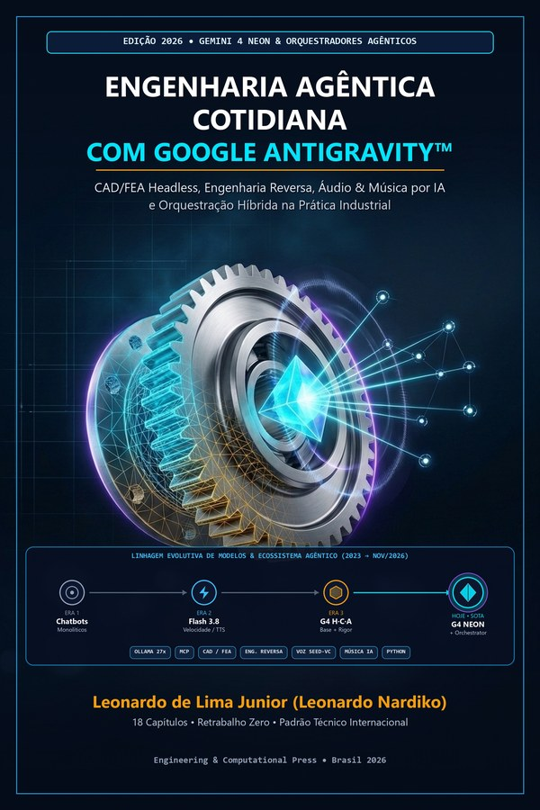
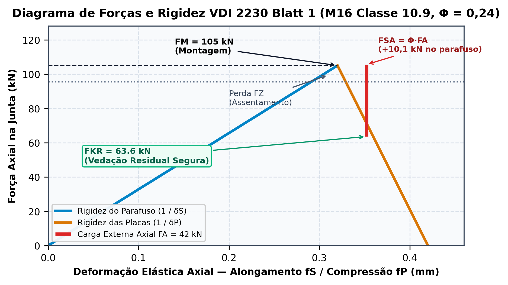
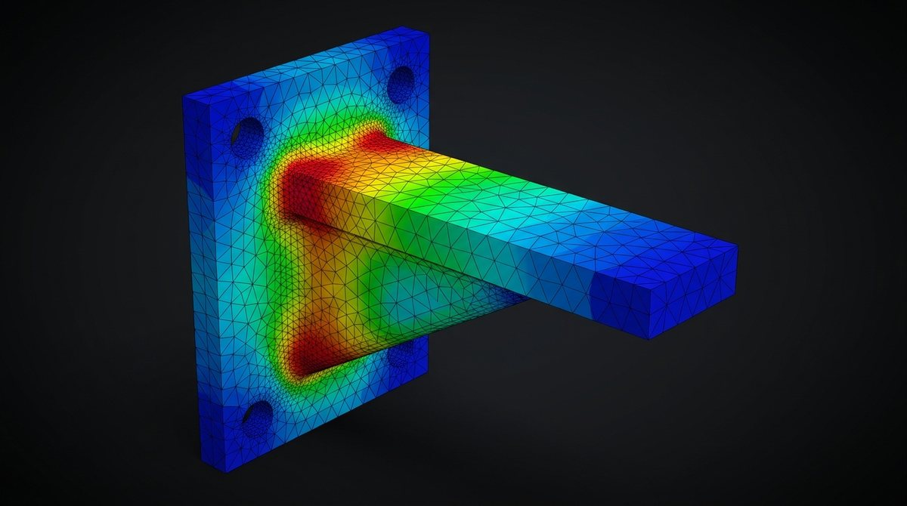

# Everyday Agentic Engineering with Google Antigravity™ — Deterministic Code Samples (2026)

[](LICENSE)
[](examples/)
[](tests/test_examples.py)

Independent companion repository of standalone, AST-verified Python engineering modules extracted from **Everyday Agentic Engineering with Google Antigravity™** (*Engenharia Agêntica Cotidiana com Google Antigravity™ — Edição 2026*): hybrid cloud-local LLM orchestration, local RTX Ollama VRAM routing, headless FreeCAD/CalculiX workflows, industrial reverse engineering, and FastMCP tool servers.

> **Zero Hallucinated Physics / Zero Rework:** LLMs should orchestrate, inspect, and assemble workflows — never guess SI units, Von Mises yield limits, or Modbus checksums in free prose. Every calculation here runs deterministically in Python and can be exposed directly to coding agents via **FastMCP**.

<p align="center">
  
</p>

---

## Included Engineering Modules (`examples/`)

| # | Script | Engineering Standard / Domain | Chapter |
|---|---|---|---|
| 01 | [`examples/01_vdi2230_bolted_joint.py`](examples/01_vdi2230_bolted_joint.py) | **VDI 2230 Blatt 1 / ABNT NBR 8800** — Assembly preload ($F_{M}$), tightening torque ($M_A$), combined tensile + torsional Von Mises stress ($\sigma_{vM}$), and R7 derated allowable preload | Cap. 10 |
| 02 | [`examples/02_cema_belt_conveyor.py`](examples/02_cema_belt_conveyor.py) | **CEMA 7th Ed. / DIN 22101 / ASME B106.1M** — Effective tension ($T_e$), Euler–Eytelwein $T_1/T_2$ equilibrium, motor power, minimum pulley diameter & shaft sizing | Cap. 11 |
| 03 | [`examples/03_modbus_crc16_telemetry.py`](examples/03_modbus_crc16_telemetry.py) | **Industrial Serial / Modbus RTU** — Big-endian telemetry packing (`struct`) and full `0xA001` CRC-16 checksum calculation + single-bit corruption detection | Cap. 07 |
| 04 | [`examples/04_fastmcp_engineering_server.py`](examples/04_fastmcp_engineering_server.py) | **Model Context Protocol (`FastMCP`) + ABNT NBR 8800** — Deterministic steel I/W-profile section properties tool ready for coding agents | Cap. 06 |

<p align="center">
  
  
</p>

---

## Quick Start (Pure Standard Library for Calculations + Tests)

```bash
git clone https://github.com/LeonardoNardiko/agentic-engineering-antigravity-samples.git
cd agentic-engineering-antigravity-samples

# Run unit tests (VDI 2230, CEMA, Modbus 0x4B37 vector, NBR 8800 W200x46.1)
python -m unittest discover -s tests -v

# Execute individual engineering modules
python examples/01_vdi2230_bolted_joint.py
python examples/02_cema_belt_conveyor.py
python examples/03_modbus_crc16_telemetry.py
python examples/04_fastmcp_engineering_server.py --demo
```

To expose `04_fastmcp_engineering_server.py` as a live **MCP tool** inside Google Antigravity or any MCP client:

```bash
pip install fastmcp
python examples/04_fastmcp_engineering_server.py
```

---

## Get the Complete Book (18 Chapters · 26 Verified Scripts · 46 Figures — R$ 29.90 / US$ 5.99 / € 5.49)

*Covers hybrid cloud-local orchestration, local RTX Ollama VRAM mutex routing, headless FreeCAD 1.1 B-Rep & CalculiX C3D10 FEA pipelines, Sentinel-2 NDVI monitoring, Playwright/messaging automation, Single-Pass AI audio & FFT sonification, and multi-agent engineering workflows.*

| Edition / Format | Platform | Direct Link | Price |
|---|---|---|---|
| **Português (Brasil) — Digital + Pacote** | **Kiwify (PDF + EPUB + Capa)** | [Comprar na Kiwify ↗](https://pay.kiwify.com.br/FdsDS05) | **R$ 29,90** |
| **Português (Brasil) — Impresso 16×23 cm** | **UICLAP Brasil** | [Comprar Impresso ↗](https://loja.uiclap.com/titulo/ua225790/) | **R$ 29,35** |
| **Português (Brasil) — eBook Oficial** | **Google Play Livros** | [Google Play PT ↗](https://play.google.com/store/books/details?id=KpIwEgAAQBAJ) | **R$ 29,90** |
| **English — Official eBook** | **Google Play Books** | [Google Play EN ↗](https://play.google.com/store/books/details?id=LJIwEgAAQBAJ) | **US$ 5.99** |
| **Español — eBook Oficial** | **Google Play Libros** | [Google Play ES ↗](https://play.google.com/store/books/details?id=JJIwEgAAQBAJ) | **€ 5,49** |
| **Deutsch — Offizielles eBook** | **Google Play Bücher** | [Google Play DE ↗](https://play.google.com/store/books/details?id=KJIwEgAAQBAJ) | **€ 5,49** |
| **Français — eBook Officiel** | **Google Play Livres** | [Google Play FR ↗](https://play.google.com/store/books/details?id=IpIwEgAAQBAJ) | **€ 5,49** |
| **Italiano — eBook Ufficiale** | **Google Play Libri** | [Google Play IT ↗](https://play.google.com/store/books/details?id=IJIwEgAAQBAJ) | **€ 5,49** |
| **Nederlands — Officieel eBook** | **Google Play Boeken** | [Google Play NL ↗](https://play.google.com/store/books/details?id=JpIwEgAAQBAJ) | **€ 5,49** |
| **Vitrine Completa & Calculadoras Web** | **TecnoPRO Engenharia** | [tecnopro.me/livraria ↗](https://tecnopro.me/livraria/) | **R$ 29,90+** |

---

## Legal & Engineering Disclaimers

* **Trademark & Independence Notice (EN):** This repository and the referenced book are **independent technical works** by Leonardo de Lima Junior. They are **not affiliated with, sponsored by, authorized, or endorsed by Google LLC**. Google, Google Antigravity, Gemini, and all engineering standards/software names (VDI, CEMA, DIN, ASME, ABNT, SKF, FreeCAD, CalculiX, Ollama, Modbus) belong to their respective owners and are used solely for technical identification and educational reference.
* **Engineering & Professional Liability Notice (EN):** All source code is provided `"AS IS"` under the [MIT License](LICENSE) **strictly for educational, research, and prototyping purposes**. Before using any calculation in structural, mechanical, or industrial production systems, results must be independently verified and signed off (e.g., ART / PE responsibility) by a licensed professional engineer.
* **Aviso Legal e de Responsabilidade Técnica (PT-BR):** Esta obra e este repositório são publicações **técnicas independentes**, sem vínculo, patrocínio ou endosso da Google LLC. Todos os códigos são fornecidos apenas para fins educacionais e de prototipagem sob licença MIT (`"AS IS"`); qualquer aplicação em projeto executivo, fabricação ou operação industrial exige verificação independente e emissão de ART por profissional legalmente habilitado no CREA.

---

## Author

**Leonardo de Lima Junior** — Multidisciplinary Engineer & Industrial Software Architect  
[TecnoPRO Engenharia](https://tecnopro.me/) • [GitHub Profile](https://github.com/LeonardoNardiko)
